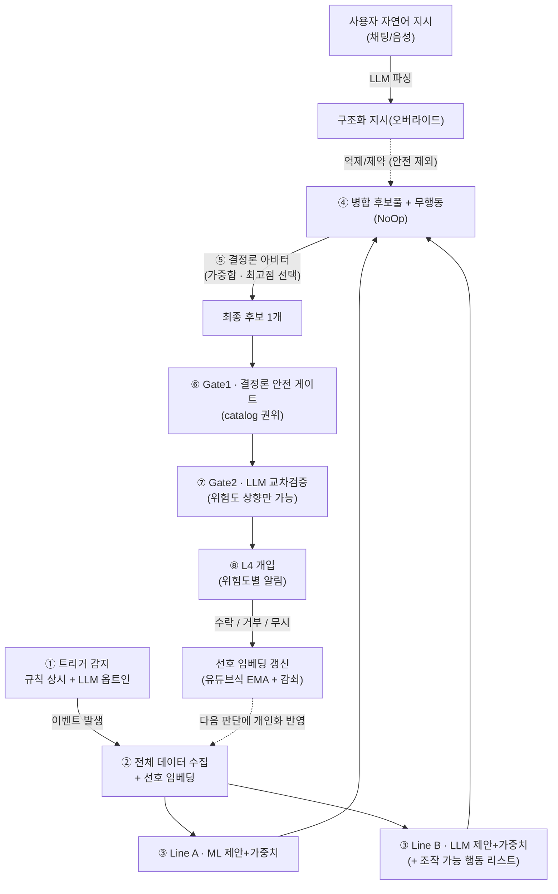

# LIOT 판단 파이프라인 개요

> Life × IoT 능동형 스마트홈 AI — 집 안팎의 상태와 사용자 선호를 종합해,
> **적절한 생활 제어 행동을 판단하고 안전하게 제안**하는 개인화 주거 운영 AI.
> 이 문서는 전체 파이프라인의 핵심만 정리한 것으로, 타인에게 설명하는 용도다.

## 한눈에 보는 전체 흐름



## 단계별 핵심

| 단계 | 이름                          | 하는 일                                                                                                              |
| ---- | ----------------------------- | -------------------------------------------------------------------------------------------------------------------- |
| ①    | **트리거 감지**               | 언제 판단을 시작할지 결정. 규칙 기반 감지가 상시 돌고, LLM 감지는 저빈도 옵트인.                                     |
| ②    | **데이터 수집 + 선호 임베딩** | 모든 센서·값 + 사용자 선호 임베딩(맥락×행동 셀맵)을 하나의 맥락으로 모음.                                            |
| ③    | **2갈래 제안**                | 두 독립 엔진이 각각 "행동 + 가중치"를 냄. **Line A**=ML 알고리즘, **Line B**=LLM(조작 가능한 행동 목록을 받아 제안). |
| ④    | **병합 후보풀**               | 두 라인의 후보 + "아무것도 안 함(NoOp)"을 한 풀로 합침.                                                              |
| ⑤    | **결정론 아비터**             | 두 제안을 결정론 가중합으로 겨뤄 **최종 후보 1개**를 고름(재현 가능·감사 가능).                                      |
| ⑥    | **Gate1 (안전 게이트)**       | 기기 카탈로그가 정한 위험도 하한을 결정론으로 부여. **안전의 최종 권위.**                                            |
| ⑦    | **Gate2 (LLM 교차검증)**      | 로컬 LLM이 위험도를 재검토. **올릴 수만 있고 절대 못 내림**(하한을 낮추려 하면 무시·인젝션 의심 기록).               |
| ⑧    | **L4 개입**                   | 위험도(4단계)에 맞춰 알림. 실제 조작은 사용자 승인 후(제안-만 모델).                                                 |

## 개인화 루프 (유튜브식)

알림에 대한 사용자 반응이 **선호 임베딩**을 계속 갱신한다.

- 임베딩 = `(시간대 × 재실 × 행동) → 선호도 0~1` 셀맵.
- **수락** → 그 맥락의 셀 ↑, **거부** → ↓, **무시/만료** → 약하게 ↓ (온라인 EMA).
- 갱신 없는 셀은 매일 중립으로 서서히 **감쇠** → 최근 취향이 우세, 옛 취향은 서서히 망각.
- 결과: 같은 맥락이 반복될수록 두 제안 라인이 그 사람 취향으로 맞춰진다.

## 자연어 지시 오버라이드 (대화형)

사용자가 채팅(또는 음성)으로 "오늘 밤은 불 계속 켜놔줘" 같은 지시를 주면,
LLM이 구조화 지시로 파싱해 **자율 제안을 억제/제약**한다.
단, 지시는 편의(comfort) 후보만 막을 수 있고 **안전은 못 낮춘다**.

## 위험도 4단계 (RiskTier)

| 단계 | 이름             | 뜻                                    |
| ---- | ---------------- | ------------------------------------- |
| 0    | 잔잔 (AMBIENT ●) | 관찰만, 개입 없음                     |
| 1    | 숨결 (BREATH ✓)  | 가벼운 능동 제안                      |
| 2    | 노을 (DUSK ?)    | 확인이 필요한 제안                    |
| 3    | 불씨 (EMBER 🛡)   | 안전 임계 — 즉시 확인, 절대 침묵 없음 |

## 상황 파급도 (SeverityLevel) — 위의 단계와 별개 축

위 4단계는 "행동을 실행하기 전에 얼마나 세게 확인받나"다. 상황 파급도는 "아무도 손대지 않으면 피해가 얼마나 커지나"다.

| 단계 | 예 | 거주자 알림 | 보호자·119 |
| --- | --- | --- | --- |
| 위험 | 가스·연기 | 최고 우선(5), 1분마다 재알림 | 90초 무응답 → 동의한 보호자 전원, +5분 → 119 전화 **안내** |
| 경고 | 오븐·고온·누수·상수도·문·도어락 | 높음(4), 10분마다 최대 3회 | 없음 |
| 주의 | 해소 알림 등 | 보통(3), 1회 | 없음 |
| 기록만 | — | 묶음 | 없음 |

- 표는 OASIS CAP 1.2 를 고쳐 쓴 것이다(`config/severity/situations.yaml`). 피해 종류 × 피해까지 시간으로 찾는다.
- 취약 거주자가 있으면 한 단계 올린다. 대상은 75세 이상·혼자 대피 어려움·인지 저하·혼자 산다.
- 로컬 결정 모델은 올리기만 한다. 모델이 올린 위험은 보호자에게 가지 않는다.

## 관통하는 안전 원칙

**"모델은 제안하고, 결정론이 고르고, 안전은 카탈로그가 지킨다."**

- 두 제안 라인(ML·LLM)과 개인화 임베딩, 자연어 지시는 모두 **선호/제안** 층위다.
- **안전 위험도는 언제나 기기 카탈로그의 결정론 값**이며, 어떤 모델·임베딩·사용자 지시도 이를 낮출 수 없다.
- 안전 임계(가스·누수 등)는 LLM이 꺼져 있어도, 사용자가 무시하라 해도 EMBER를 유지한다(Safety-Never-Silent).

## 직접 돌려보기 (관제실 데모)

이 파이프라인을 브라우저에서 그대로 실행해 볼 수 있다. 센서 값을 세팅하면 가짜
시뮬이 아니라 매 요청마다 **진짜 파이프라인**이 돌고, 단계별 산출물이 화면에 뜬다.

```bash
python -m liot.demo_server        # http://127.0.0.1:8765/
```

- **프리셋 4종**으로 상황을 한 번에 불러온다: 빈집 소등 · 가스 누출 안전 경로 ·
  라이브 등록 시연 · 외기·난방.
- **직접 등록**: 화면에서 센서·기기·행동·규칙을 추가하면 즉시 후보 생성 대상이
  된다(하드코딩 없이 카탈로그에서 파생). 단, 잠금·밸브·오븐 같은 안전 액추에이터와
  '여는 방향'은 등록으로도 능동/실행 대상이 될 수 없다.
- **개인화·지시 체험**: 폰 알림에 수락/거부하면 선호가 학습되고(다음 판단에 반영),
  "오늘 밤 불 켜놔줘" 같은 지시로 자율 제안을 억제할 수 있다 — 그래도 안전(EMBER)은
  절대 못 내린다.

> 구현 세부 계약은 `README.md`(§런타임 등록)와 `MODULE_SPEC.md`(§`liot.registry`).
> 실 ML/LLM/임베딩 학습은 아직 결정론 Fake 이며 실모델 연동은 예정이다.
